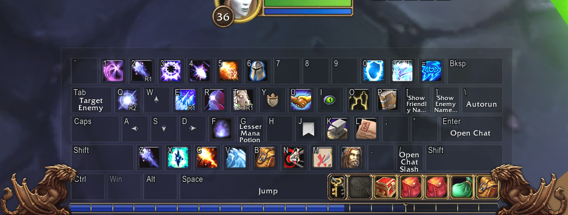
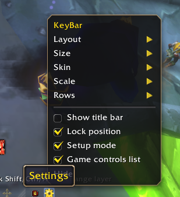

# KeyBar

An on-screen keyboard for WoW: Forever (interface 16001) that shows what each key does, with one layer per modifier.

## Install

Copy this folder into your Forever client's `Interface\AddOns` folder, as `Interface\AddOns\KeyBar`. The folder name has to match `KeyBar.toc`.

## Use

- Hold Shift, Ctrl or Alt, alone or together, and the keyboard switches to that layer. Click a Shift, Ctrl or Alt key on the board to latch that layer (it stays lit) and click it again to release it. A dimmed, grey icon means the key isn't bound on this layer, so it shows the base layer's bind instead.
- Click a key to cast or use what's bound to the layer it shows; this works in combat too. Game controls (map, autorun, ...) aren't clickable. The latch can't be changed in combat.
- Keys look like action buttons: an empty slot when unbound, the key name in the top-right corner like a hotkey, and macro and game control names under the icon (beside it on wide keys such as Tab, Shift and Space).
- Icons tint like Blizzard's action bars: red when your target is out of range (the key name turns red too), blue when you lack mana/energy, grey when unusable.
- A key that casts a lower rank than you know (a downranked macro, or an old rank on a bar) shows a small grey "R1" in the icon's corner; the tooltip adds your highest known rank. Highest-rank keys show nothing.
- Consumables (potions, food, bandages, ...) show how many you carry in that corner instead, and grey out when you have none.
- Spells bound straight to a key no longer get the spellbook's "not on your action bars" highlight.
- Move the frame by its title bar or border. The keyboard can't be moved, resized or hidden in combat.
- Skins: Minimal (default; flat and see-through), Classic (tooltip frame), Blizzard (bronze, like Blizzard's windows) and Gilded (Blizzard dialog frame, gold edges). Every skin keeps the window the same size. The title bar can be hidden; with it hidden, drag the frame's edge to move it.
- Hover the keyboard to reveal move, scale, lock, game controls and settings icons in its top-right corner. Drag the move icon to reposition; drag the scale grip left or right to resize (50%–200%, top-left corner stays put). Settings: layout (QWERTY/QWERTZ/AZERTY/UK), size (Full/TKL/75/65/60), rows, scale, lock.
- `/keybar` toggles the frame. `/keybar help` lists every command.

### Binding keys

Keys are edited like Blizzard's action bars, at any time out of combat, on whichever layer the keyboard shows:

- Drag a spell, item, macro or mount onto a key, or pick it up and click the key. If the key was already bound, its old bind lands on your cursor, so you can place it somewhere else.
- Drag a key to pick its bind up. Drop it on another key to move it, or anywhere else to clear it.
- Right-click a key for **Clear** and **Bind game control...**, which opens the game controls list aimed at that key: click a control to bind it.
- The book icon opens the game controls list (Toggle Map, Autorun, Target Nearest Enemy, ...), grouped like the Key Bindings menu. Drag a control onto a key, or click it and then click a key. Right-click, or click anywhere else, to drop it.
- The padlock locks the keys along with the frame's position and scale. While locked, clicks only cast and nothing can be dragged on or off. Holding a modifier only ever picks the layer, so Shift is free for the Shift layer.
- While unlocked, clicking a key casts when you release the mouse button, so dragging a key never casts it. Locked, mouse clicks follow the game's "cast on key down" setting.
- These binds don't use action bars (`SetBindingSpell` / `SetBindingItem` / `SetBindingMacro`), so you can hide the bars once every key is bound directly.

### Binds per character

Every character uses its own WoW binding set (Blizzard's "Character Specific Keybindings"). On a character's first login with KeyBar, a dialog asks where its binds start:

- **Keep current binds**: the character's own binds if it has them; otherwise the account's binds with only the controls kept (no other characters' spells, items or macros).
- **KeyBar defaults**: Blizzard's defaults with `1`–`=`, `Q`, `E`, `R`, `T`, `F`, `G`, `Z`, `X`, `C` and `V` cleared on the base and Shift layers; Character on `,`, friendly nameplates on `[`, enemy nameplates on `]`, Autorun on `\`, Strafe Left/Right on `A`/`D`.

After that, each character's binds are its own and KeyBar never changes them on its own.

## If a key shows the wrong bind

WoW names keys by the character your OS layout produces. Run `/keybar keytest`, press the key, and compare the printed token with the matching entry in `LOCALES` in `Layouts.lua`.

## Files

| File | Role |
|---|---|
| `Layouts.lua` | Key geometry per layout and size, in key units |
| `Bindings.lua` | Turns a key into an icon or label, plus its cooldown and tooltip |
| `Keycap.lua` | One key: a Blizzard action button on a keycap, with its click, drag and right-click handling |
| `Keyboard.lua` | Main frame: layout, layer switching and latching, press highlights |
| `ControlsList.lua` | Searchable game controls list, grouped like the Key Bindings menu |
| `Editing.lua` | Action-bar style binding: drop, pick up, held game controls, key menu |
| `Skins.lua` | Minimal, Classic, Blizzard and Gilded looks |
| `Spellbook.lua` | Marks key-bound spells as placed in the spellbook |
| `CharacterBinds.lua` | First-login choice of starting binds |
| `Core.lua` | Saved settings, options menu, slash commands, events |
